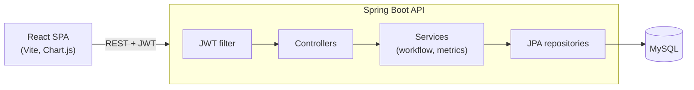

# Telecom Network Outage Monitoring

[](https://github.com/MohanraamVK/telecom-network-outage-monitoring/actions/workflows/ci.yml)

A full-stack dashboard for monitoring telecom network nodes (towers, routers) and managing outage incidents from first report to closure. It's built with **Spring Boot 4 + Spring Security (JWT)** on the backend and **React 19 + Vite** on the frontend, with MySQL for storage.

## Features

**Node monitoring**
- Create, edit, search, sort and paginate network nodes with status `ACTIVE`, `DOWN` or `MAINTENANCE`
- Soft delete with restore. Deleting a node also archives its incidents, and restoring the node brings them back.

**Incident management**
- Raise incidents against a node with severity `LOW` → `CRITICAL`
- Enforced status workflow: `OPEN ⇄ IN_PROGRESS ⇄ RESOLVED → CLOSED`. Closed incidents are final, and the UI only offers transitions the API accepts.
- Each incident records when it was opened, last updated and resolved, so you can see its age and time to resolve

**Operations dashboard**
- One API call returns every metric, counted in the database
- **Network availability** (% of nodes that are up), **MTTR** (mean time to resolve) and a banner for unresolved critical incidents
- Charts by node status, incident status and severity
- Auto-refreshes every 30 s while the tab is visible

**Security & quality**
- Stateless JWT authentication. Every API route except login and the API docs needs a token.
- No secrets in the repo: all credentials come from environment variables or a git-ignored `.env`
- Consistent JSON error responses that don't leak internals
- Unit tests for the services, the incident workflow and JWT handling, plus CI on every push

## Tech stack

| Layer    | Technology |
|----------|------------|
| Frontend | React 19, React Router 7, Axios, Chart.js, Vite 8 |
| Backend  | Java 17, Spring Boot 4, Spring Web MVC, Spring Data JPA, Spring Security, JJWT, springdoc-openapi |
| Database | MySQL 8 (H2 in-memory for tests) |
| DevOps   | Docker, Docker Compose, GitHub Actions |

## Architecture



## Quick start (Docker)

The fastest way to run everything is with [Docker Desktop](https://www.docker.com/products/docker-desktop/):

```bash
cp .env.example .env        # optional: change passwords / JWT secret
docker compose up --build
```

| Service    | URL |
|------------|-----|
| Dashboard  | http://localhost:5173 (log in with `admin` / `admin123`) |
| API        | http://localhost:8080/api |
| Swagger UI | http://localhost:8080/swagger-ui.html |

## Local development

**Prerequisites:** JDK 17+, Node 22+, and MySQL 8 running locally.

### Backend

```powershell
cd backend/network-monitor
copy .env.example .env      # then set DB_PASSWORD (and JWT_SECRET) in .env
./mvnw spring-boot:run      # Windows: .\mvnw.cmd spring-boot:run
```

The `telecomdb` database is created automatically on first start, and the schema is managed by Hibernate.

### Frontend

```bash
cd frontend
npm install
npm run dev                 # http://localhost:5173
```

### Configuration

| Variable | Default | Purpose |
|----------|---------|---------|
| `DB_URL` | `jdbc:mysql://localhost:3306/telecomdb?...` | JDBC URL |
| `DB_USERNAME` / `DB_PASSWORD` | `root` / *(empty)* | Database credentials |
| `JWT_SECRET` | dev-only value | HMAC key for tokens, **at least 32 characters**. Generate one with `openssl rand -base64 48` |
| `JWT_EXPIRATION_MS` | `86400000` (24 h) | Token lifetime |
| `CORS_ALLOWED_ORIGINS` | `http://localhost:5173` | Comma-separated browser origins |
| `ADMIN_USERNAME` / `ADMIN_PASSWORD` | `admin` / `admin123` | Account created on first start |
| `VITE_API_BASE_URL` (frontend) | `http://localhost:8080/api` | API location used by the SPA |

## API overview

All endpoints except login and the docs need an `Authorization: Bearer <token>` header. In Swagger UI, click **Authorize** and paste the token.

| Method | Endpoint | Description |
|--------|----------|-------------|
| `POST` | `/api/auth/login` | Exchange username/password for a JWT |
| `GET` | `/api/dashboard/summary` | All dashboard metrics (counts, availability, MTTR) |
| `GET` | `/api/nodes` · `/api/nodes/paged` · `/api/nodes/deleted` | List nodes |
| `GET` · `PUT` · `DELETE` | `/api/nodes/{id}` | Read, update or soft-delete a node |
| `POST` | `/api/nodes` | Create a node |
| `PUT` | `/api/nodes/{id}/restore` | Restore a node and its incidents |
| `GET` | `/api/incidents?status=OPEN` · `/api/incidents/paged` · `/api/incidents/deleted` | List incidents |
| `GET` · `POST` | `/api/incidents/node/{nodeId}` | Incidents of a node / raise a new one |
| `PUT` | `/api/incidents/{id}/status` | Move an incident through the workflow |
| `DELETE` · `PUT` | `/api/incidents/{id}` · `/api/incidents/{id}/restore` | Soft-delete / restore |

Example:

```bash
TOKEN=$(curl -s -X POST localhost:8080/api/auth/login \
  -H "Content-Type: application/json" \
  -d '{"username":"admin","password":"admin123"}' | jq -r .token)

curl -s localhost:8080/api/dashboard/summary -H "Authorization: Bearer $TOKEN" | jq
```

## Testing

```bash
cd backend/network-monitor && ./mvnw test     # JUnit 5 + Mockito, H2 in-memory
cd frontend && npm run lint && npm run build
```

GitHub Actions runs both on every push and pull request.

## Project structure

```
├── backend/network-monitor     Spring Boot API
│   └── src/main/java/com/telecom/network_monitor
│       ├── config              Security, CORS, OpenAPI, seed data
│       ├── controller          REST endpoints
│       ├── dto                 Request/response models
│       ├── entity · enums      JPA entities, incident workflow
│       ├── exception           Error handling
│       ├── repository          Spring Data JPA
│       ├── security            JWT filter and utilities
│       └── service             Business logic and metrics
├── frontend                    React + Vite SPA
│   └── src  (pages, components, context, services, utils)
├── docker-compose.yml          MySQL + API + SPA
└── .github/workflows/ci.yml    CI pipeline
```

## Roadmap

- Role-based permissions (viewer, operator, admin)
- Simulated node heartbeats that open incidents automatically when a node goes down
- Real-time updates over WebSockets/SSE
- Flyway migrations instead of `ddl-auto=update`

## Author

**Mohanraam V K**, [GitHub](https://github.com/MohanraamVK)
