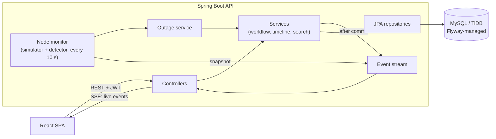

# Telecom Network Outage Monitoring

[](https://github.com/MohanraamVK/telecom-network-outage-monitoring/actions/workflows/ci.yml)

A full-stack dashboard for monitoring telecom network nodes (towers, routers) and managing outage incidents from first report to closure. It's built with **Spring Boot 4 + Spring Security (JWT)** on the backend and **React 19 + Vite** on the frontend, with MySQL for storage.

## Features

**Live monitoring**
- Every node sends a heartbeat. A built-in simulator generates realistic ones for the demo, and real devices can report through `POST /api/monitoring/nodes/{id}/heartbeat`.
- **Automatic outage detection:** a node that stays silent past the timeout is marked `DOWN` and an incident opens automatically. When its heartbeat returns, the node recovers and the incident is auto-resolved.
- Nodes in `MAINTENANCE` never alert, and a node an operator set to `DOWN` by hand is never auto-recovered.
- Per-node latency history, shown as sparklines on the overview.

**Real-time UI**
- Server-Sent Events push node, incident and monitoring changes to every open browser, with no refresh button and no polling.
- The stream is read with `fetch`, so the JWT stays in the `Authorization` header instead of the URL, and it reconnects with exponential backoff.

**Incident management**
- Enforced workflow: `OPEN ⇄ IN_PROGRESS ⇄ RESOLVED → CLOSED`. Closed incidents are final, and the UI only offers allowed moves.
- A **timeline** per incident records who did what and when: status changes, notes, and automatic detection and recovery.
- Recent activity across all incidents on the overview.

**Search and data**
- Search, filtering, sorting and pagination happen in the database (JPA Specifications), with a whitelist of sortable fields. Severity sorts by rank, not alphabetically.
- **Flyway** migrations version the schema on MySQL (existing databases are baselined automatically). TiDB Cloud rejects Flyway's history-table setup, so the TiDB deployment sets `FLYWAY_ENABLED=false` and lets Hibernate add new columns, with database defaults that keep existing rows valid.
- Optimistic locking (`@Version`): two people editing the same item get a clear 409 instead of silently overwriting each other.
- An empty database is seeded with a small Swedish network and incident history, so a fresh deployment looks alive.

**Security and quality**
- Stateless JWT auth. `ADMIN` can change data, and a read-only `VIEWER` demo account can only look (enforced by the API, not just hidden in the UI).
- No secrets in the repo, consistent JSON errors, and 48 backend tests (unit, plus integration tests against the real migrations), with CI on every push.

## Tech stack

| Layer    | Technology |
|----------|------------|
| Frontend | React 19, React Router 7, Tailwind CSS 4, Vite 8 |
| Backend  | Java 17, Spring Boot 4, Spring MVC (SSE), Spring Data JPA, Spring Security, JJWT, Flyway, springdoc-openapi |
| Database | MySQL 8 / TiDB Cloud (H2 for tests) |
| DevOps   | Docker, Docker Compose, GitHub Actions, Render, TiDB Cloud |

## Architecture



## Quick start (Docker)

The fastest way to run everything is with [Docker Desktop](https://www.docker.com/products/docker-desktop/):

```bash
cp .env.example .env        # optional: change passwords / JWT secret
docker compose up --build
```

| Service    | URL |
|------------|-----|
| Dashboard  | http://localhost:5173 (log in with `admin` / `admin123`) |
| API        | http://localhost:8080/api |
| Swagger UI | http://localhost:8080/swagger-ui.html |

## Deploy for free (Render + TiDB Cloud)

This setup costs **$0**: Render hosts the API (free Docker instance) and the frontend (free static site), and TiDB Cloud Starter provides a free MySQL-compatible database. No credit card is needed for either free tier.

> The free API instance sleeps after 15 minutes without traffic. The first request after that takes about a minute while it wakes up.

### 1. Create the database (TiDB Cloud)
1. Sign up at [tidbcloud.com](https://tidbcloud.com) and create a **Starter** instance (pick an AWS region close to Frankfurt).
2. Click **Connect**, choose **Java / JDBC**, and **generate a password**. Note the host, the username (looks like `xxxxxxxx.root`) and the password.
3. Your `DB_URL` is:
   ```
   jdbc:mysql://<HOST>:4000/telecomdb?sslMode=VERIFY_IDENTITY&enabledTLSProtocols=TLSv1.2,TLSv1.3&createDatabaseIfNotExist=true
   ```
   The `telecomdb` database and its tables are created automatically on first start.

### 2. Deploy both services (Render)
1. Sign up at [render.com](https://render.com) with GitHub.
2. **New → Blueprint** and select this repository. Render reads [`render.yaml`](render.yaml) and creates `telecom-monitor-api` and `telecom-monitor`.
3. Fill in the values it asks for:

   | Variable | Value |
   |----------|-------|
   | `DB_URL` / `DB_USERNAME` / `DB_PASSWORD` | From TiDB (step 1) |
   | `ADMIN_PASSWORD` | A strong password for the admin account |
   | `CORS_ALLOWED_ORIGINS` | `https://telecom-monitor.onrender.com` |
   | `VITE_API_BASE_URL` | `https://telecom-monitor-api.onrender.com/api` |

   If Render gives your services different URLs (shown on each service's page), update these two values to match and redeploy.
4. Open the frontend URL and log in with the read-only demo account `demo` / `demo123`, or as `admin` to make changes.

`JWT_SECRET` is generated by Render automatically. The demo account can view everything, but only the admin can create, edit, delete or restore.

## Local development

**Prerequisites:** JDK 17+, Node 22+, and MySQL 8 running locally.

### Backend

```powershell
cd backend/network-monitor
copy .env.example .env      # then set DB_PASSWORD (and JWT_SECRET) in .env
./mvnw spring-boot:run      # Windows: .\mvnw.cmd spring-boot:run
```

The `telecomdb` database is created automatically on first start, and the schema is managed by Hibernate.

### Frontend

```bash
cd frontend
npm install
npm run dev                 # http://localhost:5173
```

### Configuration

| Variable | Default | Purpose |
|----------|---------|---------|
| `DB_URL` | `jdbc:mysql://localhost:3306/telecomdb?...` | JDBC URL |
| `DB_USERNAME` / `DB_PASSWORD` | `root` / *(empty)* | Database credentials |
| `JWT_SECRET` | dev-only value | HMAC key for tokens, **at least 32 characters**. Generate one with `openssl rand -base64 48` |
| `JWT_EXPIRATION_MS` | `86400000` (24 h) | Token lifetime |
| `CORS_ALLOWED_ORIGINS` | `http://localhost:5173` | Comma-separated browser origins |
| `ADMIN_USERNAME` / `ADMIN_PASSWORD` | `admin` / `admin123` | Account created on first start |
| `DEMO_ENABLED`, `DEMO_USERNAME`, `DEMO_PASSWORD` | `false`, `demo`, `demo123` | Optional read-only demo account |
| `MONITOR_ENABLED` | `true` | Run the outage detector |
| `MONITOR_INTERVAL` / `MONITOR_HEARTBEAT_TIMEOUT` | `10s` / `30s` | How often nodes are checked, and the silence before a node counts as down |
| `SIMULATOR_ENABLED` | `true` | Generate demo heartbeats (set `false` when real devices report) |
| `SIMULATOR_FAILURE_PROBABILITY` | `0.002` | Chance per check that a healthy simulated node starts an outage |
| `SEED_DEMO_DATA` | `true` | Seed demo nodes and history into an empty database |
| `FLYWAY_ENABLED` / `JPA_DDL_AUTO` | `true` / `none` | Schema management; TiDB uses `false` / `update` |
| `VITE_API_BASE_URL` (frontend) | `http://localhost:8080/api` | API location used by the SPA |

## API overview

All endpoints except login and the docs need an `Authorization: Bearer <token>` header. In Swagger UI, click **Authorize** and paste the token.

| Method | Endpoint | Description |
|--------|----------|-------------|
| `POST` | `/api/auth/login` | Exchange username/password for a JWT |
| `GET` | `/api/events/stream` | **Server-Sent Events**: `node.changed`, `incident.changed`, `monitoring.snapshot` |
| `GET` | `/api/dashboard/summary` | All dashboard metrics (counts, availability, MTTR) |
| `GET` | `/api/monitoring/nodes` | Live health per node: status, last heartbeat, latency history |
| `POST` | `/api/monitoring/nodes/{id}/heartbeat?latencyMs=` | Report a heartbeat from a real device |
| `GET` | `/api/nodes/search?q=&status=&deleted=&page=&size=&sort=name,asc` | Search nodes (server-side) |
| `GET` | `/api/nodes/options` | Active nodes for dropdowns |
| `POST` · `PUT` · `DELETE` | `/api/nodes`, `/api/nodes/{id}` | Create, update, soft-delete |
| `PUT` | `/api/nodes/{id}/restore` | Restore a node and its incidents |
| `GET` | `/api/incidents/search?q=&status=&severity=&nodeId=&page=&size=&sort=severity,desc` | Search incidents (server-side) |
| `GET` | `/api/incidents/{id}` · `/api/incidents/{id}/timeline` | Incident details, and its full timeline |
| `GET` | `/api/incidents/activity?limit=20` | Latest timeline entries across all incidents |
| `POST` | `/api/incidents/node/{nodeId}` | Raise an incident |
| `PUT` | `/api/incidents/{id}/status` | Move an incident through the workflow |
| `POST` | `/api/incidents/{id}/notes` | Add a note to the timeline |
| `DELETE` · `PUT` | `/api/incidents/{id}` · `/api/incidents/{id}/restore` | Soft-delete / restore |

Read endpoints work for any logged-in user. Everything that changes data needs the `ADMIN` role.

Example:

```bash
TOKEN=$(curl -s -X POST localhost:8080/api/auth/login \
  -H "Content-Type: application/json" \
  -d '{"username":"admin","password":"admin123"}' | jq -r .token)

curl -s localhost:8080/api/dashboard/summary -H "Authorization: Bearer $TOKEN" | jq
```

## Testing

```bash
cd backend/network-monitor && ./mvnw test     # JUnit 5 + Mockito, H2 in-memory
cd frontend && npm run lint && npm run build
```

GitHub Actions runs both on every push and pull request.

## Project structure

```
├── backend/network-monitor     Spring Boot API
│   └── src/main/java/com/telecom/network_monitor
│       ├── config              Security, CORS, OpenAPI, scheduling, seed data
│       ├── controller          REST endpoints
│       ├── dto                 Request/response models
│       ├── entity · enums      JPA entities, incident workflow and timeline
│       ├── exception           Error handling
│       ├── monitoring          Heartbeat registry, simulator, outage detector
│       ├── realtime            Server-Sent Events stream
│       ├── search              Specifications and safe sorting
│       ├── repository          Spring Data JPA
│       ├── security            JWT filter and utilities
│       └── service             Business logic and metrics
│   └── src/main/resources/db/migration   Flyway SQL migrations
├── frontend                    React + Vite SPA
│   └── src  (pages, components/ui, context incl. live SSE, services, utils)
├── docker-compose.yml          MySQL + API + SPA
└── .github/workflows/ci.yml    CI pipeline
```

## Roadmap

- Notification channels (email or Slack) when a critical incident opens
- Per-node SLA targets and monthly availability reports
- Real device agents in place of the simulator

## Author

**Mohanraam V K**, [GitHub](https://github.com/MohanraamVK)
